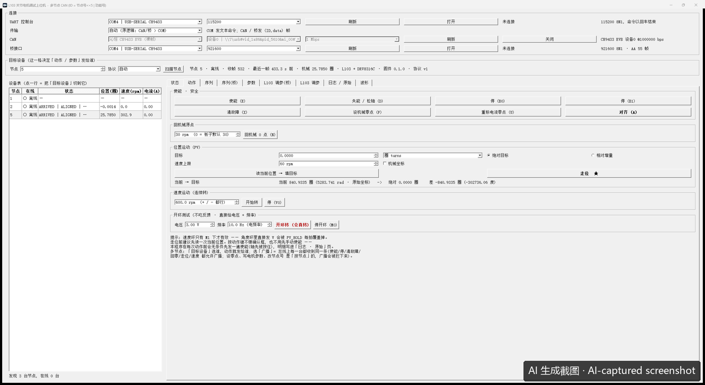

# L103MotorControl —— CH32L103 关节电机调试上位机（Qt）

[中文](README.md) | [English](README.en.md)

给 **CH32L103 关节电机驱动板**用的 Windows 图形上位机。两块板共用同一套界面：

| 板子 | 驱动 | 编码器 | 固件仓库 |
|---|---|---|---|
| L103 + DRV8313 | `DRV8313` | `AS5600`（I2C） | [`l103-drv8313-as5600`](https://github.com/bjthemost-hub/l103-drv8313-as5600) |
| L103 + DRV8316C | `DRV8316C` | `MT6701`（SPI） | [`l103-drv8316c-joint`](https://github.com/bjthemost-hub/l103-drv8316c-joint) |



> 这张封面截图是 **AI 操作本程序后自己截的**（右下角有标注）。

MIT License。

---

## 它解决什么问题

以前调这两块板是在串口助手里手敲命令 —— `G1.8888@600`、`*{0,60,90,0}{1000000,-60,90,0}`、
`M1` / `M2` 切模式，还得自己算 CAN 的 8 字节小端打包。手敲错一个字段，机构真的会跑飞。
这个程序把固件的命令表做成界面：能点的地方就不用手敲。

## 功能

| 页 / 区域 | 内容 |
|---|---|
| 连接 | UART 控制台（默认 **115200 8N1**）、CAN（**1 Mbps**）两条通道；CAN 支持**沁恒 CH9433 EVB 裸帧**与**达妙 DM-USB2CAN 30 字节信封**两种转接卡 |
| 目标设备 | CAN ID = `(节点号 << 5) \| 功能号`；节点 0 = 广播，1–63 = 设备地址。一条总线可挂多台板 |
| 设备表 | 自动认在线节点，点一行就切目标；显示状态 / 位置 / 速度 / 电流 |
| 动作 | 使能、失能·松轴、停、清故障、设机械零点、重校电流零点、**对齐** |
| 位置运动（PV） | 绝对目标 / 相对增量，单位可选圈或度；当前 → 目标、走位、回机械原点 |
| 速度运动 | 连续转，带启动与停 |
| 开环测试 | 直接给电压与频率，不读反馈 —— **换板 / 换电机 / 改相序之后的第一步** |
| 参数页 | 按板型选表（L103 的 16 项 / 桥的 27 项），读写 RAM、**存 Flash (SAVE)**；界面只做下发，业务逻辑在固件里 |
| 序列 | 多段动作排成序列，可给多台板各装各的段再广播起跑 |
| 波形 | 相电流实时曲线（UART 流，9 字节/帧） |
| 日志 | 每条发出的帧与收到的回帧，可原始显示 |

## 编译

需要 **Qt 5.14.0 MinGW 64**（含 `Qt5SerialPort`）：

```powershell
pwsh -NoProfile -File scripts\build.ps1     # qmake + mingw32-make
pwsh -NoProfile -File scripts\deploy.ps1    # 把 Qt 运行时 DLL 拷进 build\
build\L103MotorControl.exe
```

默认路径写在脚本里（`C:\Qt\Qt5.14.0\5.14.0\mingw73_64`），装在别处就改脚本开头的两个变量。

**CAN 需要一颗厂商 DLL**：`USBCANx64.dll`（WCH CH9433 EVT 自带的那个）。
放到下面任一位置即可，程序按这个顺序找：

1. exe 同目录；
2. 运行目录（当前工作目录）；
3. `third_party\CH9433EVT\lib\`（相对 exe）。

找不到也能开程序，只是 CAN 页枚举不到设备 —— UART 通道不受影响。

## 协议与文档

- `docs/使用说明.md` —— 逐页操作说明、安全动作顺序、常见问题。
- `docs/需求文档_V1.0.md` —— 每条界面行为对应的需求与出处。
- 固件命令表在各自的固件仓库里（`firmware/命令表与使用说明_UART与CAN_2026-09-28.md`、
  `firmware/docs/命令表_CAN与UART_2026-10-16.md`）。

> **上位机只是中间商**：按钮写什么就发什么，钳位与保护在固件里。对齐会硬拽转子，
> 上电后先确认轴能自由转；发现不转、抖动、转速不跟随，先停机。

## 关于 AI 辅助

这个程序的界面、协议层与文档在设计和编码过程中**大量使用了 AI 辅助**（OpenAI Codex / GPT 系列模型），
包括 README 封面那张截图 —— 由 AI 操作程序、截取窗口并加上标注。代码经人工审阅，并在两块真实板卡上联调验证。
AI 是工具，不是作者。

## 许可

MIT，见 `LICENSE`。